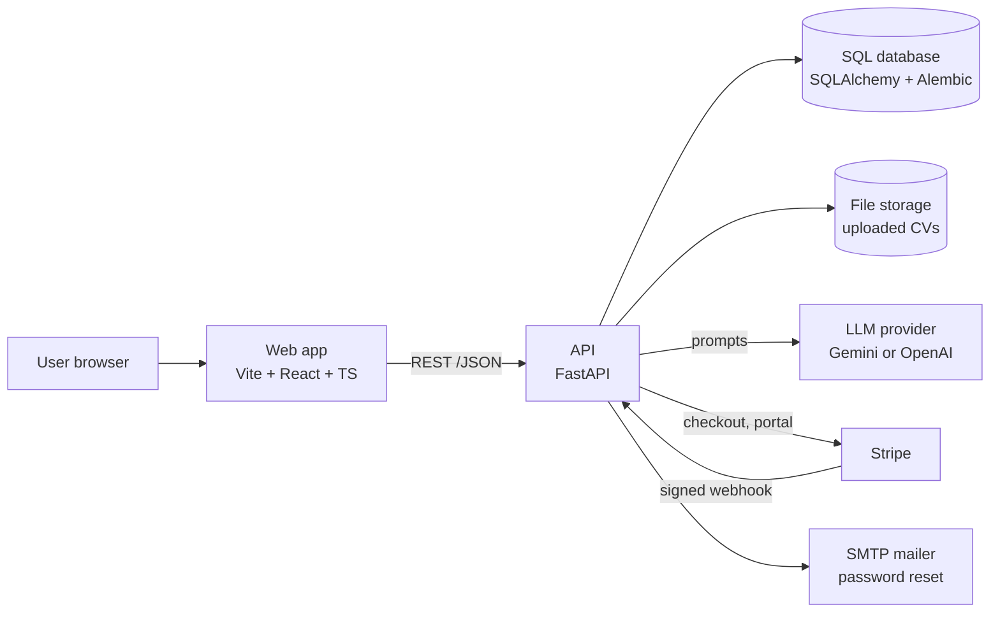

# ShortlistMe

AI-assisted CV tailoring: upload a CV, paste a job description, and get a version of the CV rewritten for that role.

> **Status: in development.** ShortlistMe runs locally and has not been publicly launched or deployed.

## Features

- Account sign-up and login
- Upload and manage CVs
- Add job descriptions and match a CV against them
- AI-generated tailoring and rewrite suggestions
- Stripe-based billing endpoints

## Tech stack

| Layer | Technology |
| --- | --- |
| Backend | FastAPI, SQLAlchemy, Alembic |
| Frontend | Vite, React, TypeScript |
| AI | Gemini or OpenAI, configured by environment variable |
| Payments | Stripe |
| Email | SMTP |
| Tooling | Docker Compose |

## Project structure

```
backend/
  app/
    api/        auth, billing, cvs, jds, matches, rewrites, tailoring, health
    services/
    models/
frontend/
  src/          pages and UI components
docker-compose.yml
.env.example
```

## Getting started

1. Copy `.env.example` to `.env` and fill in your own LLM, SMTP and Stripe values. Never commit `.env`.
2. Start the stack:

   ```bash
   docker compose up --build
   ```

3. API: http://localhost:8000 · Web app: http://localhost:5173

## Tests

The backend has a test suite (152 tests). Run it from `backend/` with `pytest`.

## High-level design (HLD)



Main flow:

1. The user signs up and uploads a `.docx` CV. The API validates and parses it into structured blocks.
2. The user adds a job description.
3. The user starts a tailoring job. The API returns `202` straight away and runs the pipeline in the background.
4. The web app polls the job until it is `done`, then shows the match score, the proposed edits and any edits that were dropped.
5. The user exports the edited CV as `.docx` or `.pdf`.

Design decisions:

- **Asynchronous tailoring.** LLM calls are slow, so `POST /tailoring` queues a job and the client polls `GET /tailoring/{id}`.
- **Edits are checked.** Proposed rewrites pass through a validator before they reach the user. Edits that fail are returned separately as `dropped`.
- **Usage limits and billing** are enforced server-side, with Stripe as the source of subscription state through webhooks.

## Low-level design (LLD)

### API surface

| Router | Endpoints |
| --- | --- |
| `auth` | `POST /signup`, `/login`, `/refresh`, `/logout`, `/forgot-password`, `/reset-password` |
| `cvs` | `POST /` (upload), `GET /{id}`, `POST /{id}/export.docx`, `POST /{id}/export.pdf` |
| `jds` | `POST /`, `GET /{id}`, `POST /{id}/analysis` |
| `matches` | `POST /` |
| `rewrites` | `POST /` |
| `tailoring` | `POST /` (returns 202), `GET /{job_id}` |
| `billing` | `GET /` (usage), `POST /checkout`, `POST /portal`, `POST /webhook` |
| `health` | `GET /health` |

### Data model

| Table / model | Notable columns |
| --- | --- |
| `User` | `id` (UUID), `email` (unique), `password_hash`, `stripe_customer_id`, `subscription_status`, `created_at` |
| `CV` | owner, stored file key, `parsed` (structured JSON) |
| `JobDescription` / `JDAnalysis` | job description text and its structured analysis |
| `TailoringJob` | `user_id`, `cv_id`, `jd_id`, `status`, `step`, `error`, `result` (JSON), timestamps |
| `RefreshToken`, `PasswordResetToken` | token records, stored hashed |

### Tailoring job state machine

```
status: queued -> running -> done | failed
step:   queued -> analysing -> matching -> rewriting -> done
```

`services/tailoring.run` is the single entry point. It records progress on the job row after each step and never raises: an `LLMError` or any other failure is saved on the job as `failed` with a user-safe message.

### Service layer (`backend/app/services`)

| Module | Responsibility |
| --- | --- |
| `parsing/docx_parser`, `parsing/locator` | Turn a `.docx` into structured blocks and locate text within them |
| `docx_validation` | Reject invalid uploads (`InvalidCV`) |
| `jd_analysis` | Extract structured requirements from a job description |
| `matching` | Compare CV against the requirements and mark each item covered, weak or a gap; compute the score |
| `rewriting` | Ask the LLM for proposed edits (`propose`) |
| `validator` | Check each edit against the original CV (numbers, names, seniority and other tokens) so rewrites cannot add facts |
| `exporting` | Apply accepted edits to the original `.docx`; render a PDF |
| `llm` | Provider call with `generate`, `generate_json` and `generate_model` (schema-validated output) |
| `security` | Password hashing, access and refresh tokens |
| `login_limiter`, `rate_limiter` | Failed-login blocking and request rate limiting |
| `billing` | Usage counting, Stripe checkout and portal URLs, webhook signature check, applying events |
| `mailer`, `storage` | SMTP sending; reading and writing stored files |

### Frontend

- Pages: `Landing`, `SignUp`, `Login`, `ForgotPassword`, `ResetPassword`, `Dashboard`, `UploadCV`, `AddJD`, `Tailor`.
- `api.ts` wraps the REST calls; `session.ts` holds the signed-in session.

## Status and roadmap

In development. Public deployment and launch are not done yet.
